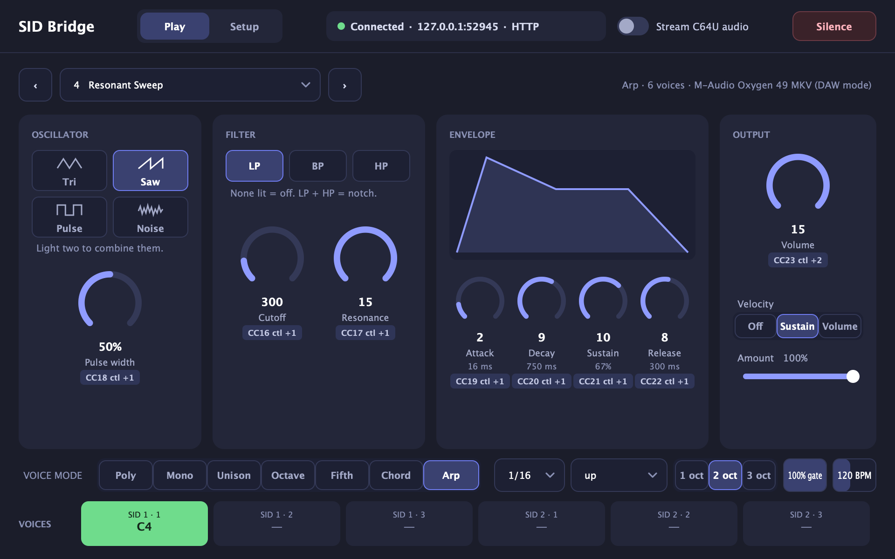

# MIDI → C64 Ultimate SID bridge

Play the real SID chips in a Commodore 64 Ultimate from a USB MIDI keyboard on another
computer. The computer works out every SID register value and writes it into the C64's
I/O space over the network, through the Ultimate DMA Service (or the REST API if that's
switched off). Nothing runs on the C64, which just sits at the BASIC prompt.

There are two front ends, and both use the same engine:

- **`bridge.py`**: a Python command-line bridge. It's the prototype, and it's the reference
  that the C++ version is checked against.
- **SID Bridge**: a JUCE instrument plugin (VST3 and AU) plus a standalone app, built from
  `cpp/`.



## What it does

- Seven voice modes: **poly** (3 voices per SID, 6 with two; the oldest note is stolen),
  **mono** (legato), **unison** (every voice, detuned), **octave**, **fifth** and **chord**
  (each note stacked +12 / +7 / +7 and +12), and an **arpeggiator** (1/4 to 1/32 including
  triplets; up, down, up-down, random, as played; 1-3 octaves; gate). The arpeggiator follows
  MIDI clock when it arrives, otherwise the DAW's tempo (plugin) or a BPM setting.
- Split layout: MIDI channel 1 plays SID 1 and channel 2 plays SID 2, each with its own patch.
- Any MIDI keyboard: a **controller profile** says what its knobs, faders, pads and buttons do
  (see [Your controller](#your-controller-profiles)). Profiles for a generic keyboard and the
  M-Audio Oxygen 49 MKV are included.
- Live control of cutoff, resonance, pulse width, ADSR and volume.
- Pitch bend, a sustain pedal, presets on program change (`presets.toml`), and a panic.
- Velocity: by default each note's sustain level follows how hard you play it. It can also
  drive the master volume instead, or be switched off (`[engine] velocity`, or the plugin's
  Velocity and Vel Amt controls).
- Pads and buttons can trigger actions: next filter mode, next/previous preset, next waveform,
  panic. With the Oxygen profile, pad 1 steps the filter mode LP → BP → HP → off (set the
  Oxygen's pads to channel 10 first: tap a pad, hold SHIFT and press CHANNEL UP/DOWN).
- Reconnects automatically if the network drops, then rewrites every register.
- Only one bridge can drive a C64U at a time. The script and the plugin share a lock file.

The bridge uses the **Ultimate DMA Service** (C64U menu → Network Settings) by default and
falls back to the REST API when it's off. See [Latency](#latency-what-to-expect).

## Latency: what to expect

Short version: playing live through the C64U's own audio output feels like a hardware synth
over MIDI, a few milliseconds behind your key. **Stream C64U audio** is for recording and
monitoring in a DAW, not for tight live playing: it adds about 40 ms.

All numbers were measured on a C64 Ultimate (firmware 1.2.1) on wired Ethernet; the details
are in `NOTES.md`.

| Step | Typical time | Notes |
|---|---|---|
| A SID register write reaches the chip | **≈ 1 ms** over the DMA service, **≈ 7 ms** over HTTP | HTTP is limited by the C64U's web server, not the network; Wi-Fi vs Ethernet made no difference to it |
| Note on → the SID plays it (C64U's audio out) | **a few ms** (estimate: MIDI in + up to one 5 ms flush + the write above) | Not measured directly: that needs a cable from the C64U's output back into an audio input |
| Note on → sound in the C64U's network audio stream | **≈ 40 ms** (DMA), ≈ 42 ms (HTTP) | Measured end to end; most of it is the stream's own buffering. The Python bridge and the plugin are within 1 ms of each other |
| **Stream C64U audio** in the plugin | adds a **≈ 20 ms** buffer on top | So DAW monitoring of the C64 is roughly 40–60 ms behind the key |
| Turning a knob → the new value on the chip | usually a few ms; **25 ms** worst case | Worst case = both SIDs' cutoff changed every millisecond for 3 s (DMA) |

Things that affect it:

- **Use the DMA service.** It's on by default and SID Bridge says "via DMA" when it's in use.
  Switch it on in the C64U menu → Network Settings → Ultimate DMA Service.
- **In a DAW**, notes from a track go out when the host processes its audio block, so add up to
  one buffer (e.g. 512 samples ≈ 11 ms at 48 kHz). Playing straight from your keyboard via
  **Notes in** avoids that.
- **Timing jitter:** notes are timed on the computer and sent over the network, so expect a
  few ms of jitter. The arpeggiator measured 250 ms steps at 249.5 ms on average (sd 15 ms).
  Very fast sequences (steps of 20 ms or less) can show the occasional 70–120 ms hiccup from
  the C64U's network handling, so frame-exact chip tricks aren't what this is for.
- **Recording the C64 into a DAW** with Stream C64U audio: the recorded track is late by the
  stream delay. SID Bridge doesn't report a latency to the host yet, so nudge the recorded
  audio earlier by about 40–60 ms, or record the C64U's analog output instead.

## Getting the code

```sh
git clone --recursive https://github.com/dantaipan/sid-bridge.git
# already cloned without --recursive?  git submodule update --init   (JUCE, for the plugin)
```

## Python bridge

```sh
python3.12 -m venv .venv && .venv/bin/pip install -r requirements.txt
.venv/bin/python bridge.py --list-ports
.venv/bin/python bridge.py --ui            # play; Ctrl-C = panic + quit
.venv/bin/python bridge.py --split --preset "Saw Bass"
.venv/bin/python bridge.py --find          # look for C64 Ultimates on your network
.venv/bin/python bridge.py --sids          # what the C64U has mapped
.venv/bin/python bridge.py --http          # REST API instead of the DMA service
.venv/bin/python bridge.py --list-profiles # controller profiles; --profile NAME|PATH to pick one
.venv/bin/python -m pytest                 # 139 tests
```

Settings live in `config.toml` (C64U address, SID addresses, the controller profile, sound
and velocity options). Put your own changes in `config.local.toml` (same format, read on top,
kept out of git), for example `[device] host = "192.168.1.64"`. With no address set,
`bridge.py` searches the network and uses the C64U if it finds exactly one.

## Plugin and standalone app

```sh
cd cpp
cmake --preset release && cmake --build --preset release   # also installs the AU/VST3
ctest --preset release                                     # core + parity + plugin tests
```

The build produces `cpp/build/release/plugin/SidBridge_artefacts/Release/{VST3,AU,Standalone}`.
A Release build copies the AU and VST3 into `~/Library/Audio/Plug-Ins`.

To use it:

1. Load **SID Bridge** as an instrument (or open the standalone app). The first time, it opens
   on **Setup**:
   - **Your C64 Ultimate**: it searches your network by itself (**Find** does it again) and
     connects when it finds one. You can also type the address. "More settings" has the
     network password, SID addresses, DMA or HTTP, and PAL or NTSC.
   - **Your keyboard**: pick your controller's **Profile**. **Notes in** can open a keyboard
     directly (lowest latency in the standalone app; host MIDI is then ignored). **Controls in**
     is a second input for knobs and buttons; "Auto" uses the one named in the profile.
   - **How you play** (optional): poly or split layout, poly or mono voices, which SID the
     knobs change, and your own presets file. In the standalone app also the **Audio output**
     (only used by Stream C64U audio).
   In the standalone app, an empty **Notes in** ("Auto") opens the keys port named in the
   profile; there is no separate Options / Audio-MIDI dialog.
   When it's connected, **Start playing** takes you to the **Play** tab. From then on it opens
   on Play.
2. **Play** has the preset bar and the sound in four sections: oscillator (light two waveforms
   to combine them), filter (LP / BP / HP, none = off), envelope (with the real times), and
   output (volume and velocity). The **Voice mode** bar below picks poly, mono, unison,
   octave, fifth, chord or arp (rate, pattern, octaves, gate and tempo appear for arp). The knobs are ordinary automatable parameters: MIDI CCs, your
   controller and presets move them too, so the host can record them.
3. **MIDI learn**: right-click a knob, a filter or waveform button, a preset arrow, or Silence,
   choose "MIDI learn...", and move a control on your keyboard. It's saved to your own copy of
   the profile ("... (mine)") and works straight away. The small label under each knob shows
   what controls it; "Forget" in the same menu removes it.
4. **Silence** stops every note on the C64 at once (the volume comes back with the next note):
   for a note stuck because its note-off got lost.
5. **Stream C64U audio** plays the C64U's network audio stream out of SID Bridge, so you hear
   the real SIDs through your audio interface and a DAW can record them on the plugin's track.
   It adds roughly 30–40 ms on top of the C64U's own output, so for playing live the C64U's
   audio out is snappier. The C64U streams to one place at a time: this takes the stream over
   from PS64.

Without **Stream C64U audio** the plugin's own output is silent: the sound comes out of the C64U.

**About SID Bridge** (version and licensing): click the "SID Bridge" title or the "Made with
JUCE" footnote on Setup; in the standalone app also SID Bridge menu → About SID Bridge.

**Updates:** the standalone app asks GitHub once a day whether a newer release is out (it can
be switched off in About) and has SID Bridge → Check for Updates…; the plugin checks only when
you press "Check for updates" in About. Nothing is sent beyond a request for the latest
release of [dantaipan/sid-bridge](https://github.com/dantaipan/sid-bridge/releases).

## Releasing

`tools/make_release.sh` builds the app, the AU and the VST3 universal (Apple Silicon + Intel),
signs them with Developer ID (hardened runtime), notarizes and staples them, and makes
`dist/SID-Bridge-<version>.dmg`, also signed, notarized and stapled. It needs a
"Developer ID Application" certificate and notarytool credentials (see the script). The
version is the CMake project version in `cpp/CMakeLists.txt`. Publish the disk image as GitHub
release `v<version>` with notes from `docs/releases/`; the update checker looks there.

## Licence

GNU AGPL 3.0 or later (see LICENSE). The plugin and app are built with
[JUCE](https://juce.com), whose modules are dual-licensed under the
[GNU AGPLv3](https://www.gnu.org/licenses/agpl-3.0.en.html) and the commercial
[JUCE licence](https://juce.com/legal/juce-9-licence/); SID Bridge uses JUCE under the AGPL.

## Your controller: profiles

A controller profile is a small TOML file that describes one MIDI keyboard or controller:
its MIDI ports, which channel the keys use, the pitch-bend range, and a `[[control]]` entry for
each knob, fader, wheel, pedal, pad or button. `profiles/generic.toml` explains every option at
the top; copy it to start your own. Both the Python bridge and the plugin read the same files.

```toml
name = "My keyboard"

[keys]
channel = 0                 # 0 = any channel
ignore_channels = [10]      # e.g. pads on channel 10 never play notes

[[control]]                 # an ordinary knob sending CC 74
cc = 74
param = "cutoff"

[[control]]                 # an endless knob on a second "DAW" port
port = "controls"
cc = 16
mode = "relative-signed"
param = "resonance"

[[control]]                 # a pad
note = 36
channel = 10
action = "preset_next"
```

- To see what your controller sends: `.venv/bin/python bridge.py --monitor`.
- **Python bridge:** put the file in `profiles/` and set `[controller] profile = "<name>"` in
  `config.toml`, or pass `--profile path/to/file.toml`.
- **Plugin / app:** Profile → "Open profiles folder..." opens
  `~/Library/Application Support/SID Bridge/Profiles` (with the built-ins as examples). Files
  there show up in the Profile box. A file with a built-in's name replaces that built-in.
- A mistake in a profile names the file and the line. The plugin then falls back to the generic
  profile and says why in its status line.

## Layout

| Path | What |
|---|---|
| `sid.py`, `transport.py`, `engine.py`, `bridge.py` | Python: SID model, HTTP transport and flusher, engine, CLI |
| `presets.toml`, `config.toml` | Patches; bridge settings |
| `profiles/`, `profiles.py` | Controller profiles (built into the plugin too) and their reader; `tests/profiles/test-all.toml` exercises every option |
| `cpp/core` | C++ port of the engine (no JUCE), with Catch2 tests |
| `cpp/core/tests/vectors` | Golden vectors from `tools/gen_vectors.py`. The C++ engine must reproduce the Python engine's register writes byte for byte |
| `cpp/plugin` | JUCE plugin: `BridgeController` (threads, params, lock), processor, editor, headless tests |
| `listen.py` | Records and analyses the C64U's audio stream, for checking sound without ears |
| `tools/e2e_latency.py` | End-to-end test: virtual MIDI → bridge or plugin → C64U → recorded audio |
| `probe.py`, `bench.py` | Phase 0 and 2 hardware probes and benchmarks |
| `NOTES.md` | Confirmed API details, measurements, gotchas |
| `PLAN.md` | The phased plan, its status, and future enhancements |

After changing the Python engine, regenerate the vectors with
`.venv/bin/python tools/gen_vectors.py`. `pytest` fails if you forget.
